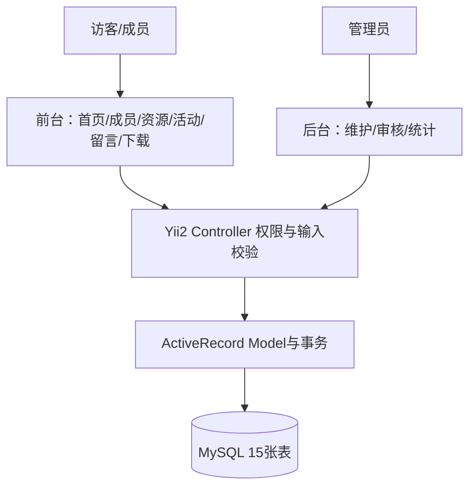
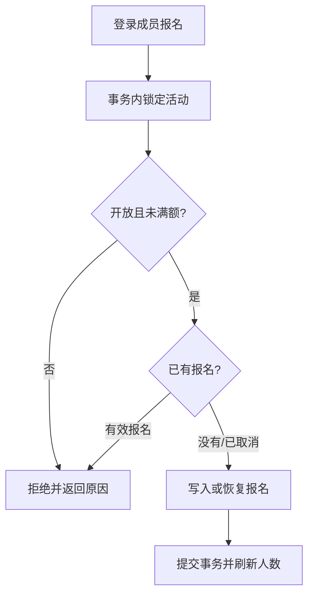

# 数据库与模块设计草案

15张业务表，统一InnoDB、utf8mb4、BIGINT自增主键，外键与唯一约束见项目/data/install.sql。建表脚本不包含DROP，不操作现有数据库。实际导入前由部署者选择新数据库并确认连接。

|表|用途|关键关系|
|---|---|---|
|user|登录、角色、状态与密码哈希|用户名/邮箱唯一|
|team|团队名称、简介|团队与成员一对多|
|member_profile|个人展示资料|user_id唯一，所属team|
|announcement|公告发布|作者user|
|assignment_file|团队/个人作业下载登记|上传者user；相对路径|
|resource_category|资源分类|名称唯一|
|resource|学习资源|分类、发布者|
|tag|资源标签|名称唯一|
|resource_tag|资源标签关联|resource_id＋tag_id唯一|
|resource_favorite|收藏|user_id＋resource_id唯一|
|activity|活动安排与容量|创建者user|
|activity_registration|活动报名状态|activity_id＋user_id唯一|
|guestbook_message|团队留言与审核状态|留言者user|
|resource_comment|资源评论与审核状态|资源与用户|
|audit_log|后台操作记录|操作者、对象类型与ID|

字段类型、空值、默认值、索引、外键在SQL中逐项定义，是后续正式数据字典的依据。user沿用Yii2 Advanced需要的auth_key、password_hash、password_reset_token等字段，登录模型后续适配角色字段。Yii migration自带历史表不计入15张业务表。

逻辑删除用于发布内容与用户停用；关联表删除按SQL级联处理，后台日志保留。正式实现时补充ER图、各页面流程与详细数据字典，不把此草案当作完成的设计报告。
